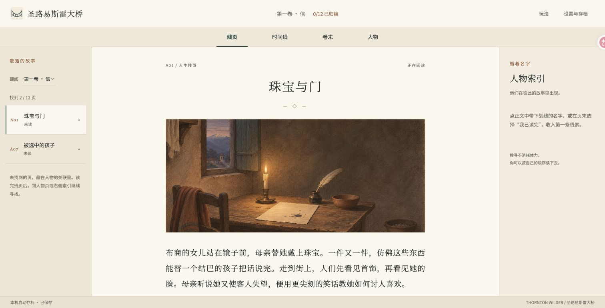

# 本体 1.0.0 验证记录

日期：2026-11-10。验证对象是本仓库完整本体，不是前期六片段预览。

## 内容与规则

- 36 张卡、3 卷、12 人物、6 节尾声；全部人物搜寻路径可达。
- 主线正文 16,342 个非空白字符；序幕、卷首与尾声合计后为 19,624。所有卡均有原著出处。
- 15 条选读与本地中文 PDF 提取文本逐字匹配，忽略排版空白；不代表已逐页图像校定整本译文。
- 24 项图像、音频、图标及字体登记 SHA-256，运行引用素材均存在。
- 16 组测试覆盖 12 种完整搜寻顺序，每次动作后验证书签可恢复；错误回答、错误归档、未读卡、未来卡和提前过卷均受到约束。
- 保存测试覆盖连续串行写入、迟到读取、读取失败、损坏存档、写入重试、平台未登录；平台异常不降级为本地空档。
- 完成判定必须经过全部尾声；梦境不混入真实时间轴。

当前 GitHub CI 未启用：上传凭据缺少 `workflow` 权限，配置保存在 `ci-verify.example.yml`。以后启用时，公开 CI 没有已购原书，会明确输出“未执行购书逐字校对”，其余检查仍运行。作者机器生成的 `docs/内容校验.json` 包含本地原文匹配结果；CI 不会伪造这一步。

## 实际浏览器操作

Chrome 桌面：从新书签开始，阅读、辨认、归档全部 36 页；完成 9 个卷末事实问题、三卷与六节尾声；进入读后页并保留页边记。人物、阶段答错均有反馈，可修正。第一卷完成后刷新，12 页进度恢复。通关书签下载为真实 JSON，验证包含 36 页和完整状态。

生产构建手机布局：390 × 844 和 320 × 740。封面与正文无横向溢出；目录可展开收起；人物页可搜寻新残页；23 px 字号和关闭音乐在刷新后保留。未归档全卷时，卷末确认禁用。

通过实际文件选择器导入：损坏 JSON 明确报错，原进度保持；完整书签正确恢复到读后页。通关后的三卷回看从 A01 开始，卷次切换可用。下载书签文件名使用本地日历日期。

修正并复查：设置弹窗内显示导入错误；320 px 封面标题和按钮不折断；手机封面顶部留白；重新开始清除目录抽屉状态；通关回看首张选中一致。

本机 M02 实际媒体播放，播放时间推进，无媒体错误；关闭后暂停。7 个 M4A 文件由系统解码器识别为 44.1 kHz、双声道 AAC。不以此代替逐曲人工听审。浏览器检查未见应用控制台错误或警告。

## 构建与依赖

类型检查、规则测试、内容校验与生产构建统一为 `npm run check`。构建依赖更新为 Vite 6.4.6、esbuild 0.28.2；更新后 npm audit 未报告已知漏洞。升级依据：[Vite 6 官方迁移说明](https://v6.vite.dev/guide/migration.html)。

图片、音乐和字体均为本地文件；游戏运行不调用生成 API。静态资源和字体使用相对路径。启动脚本仅提供 `dist/`，不把本地知识库作为网站目录提供。

## 尚未验证

1. 未读原著玩家首次完整阅读是否超过 40 分钟；自动走完约数分钟不代表真人时长。
2. 真机触控、iOS Safari、Android 浏览器和无障碍读屏器；手机检查目前是 Chrome 响应式视口。
3. 五首曲子的完整人工听审、循环主观听感和移动设备自动播放政策；首尾淡化不等于无缝循环。
4. 幻光正式发布后的真实 SDK 云存档、跨设备恢复与 S2 提交验收。

这些边界不影响本机完整本体从开始到结尾运行，但不能写成已通过。

最终 Vite 6.4.6 生产构建再次在浏览器打开并进入第一张残页，图片正常加载，页面无横向溢出，控制台未见错误或警告。
